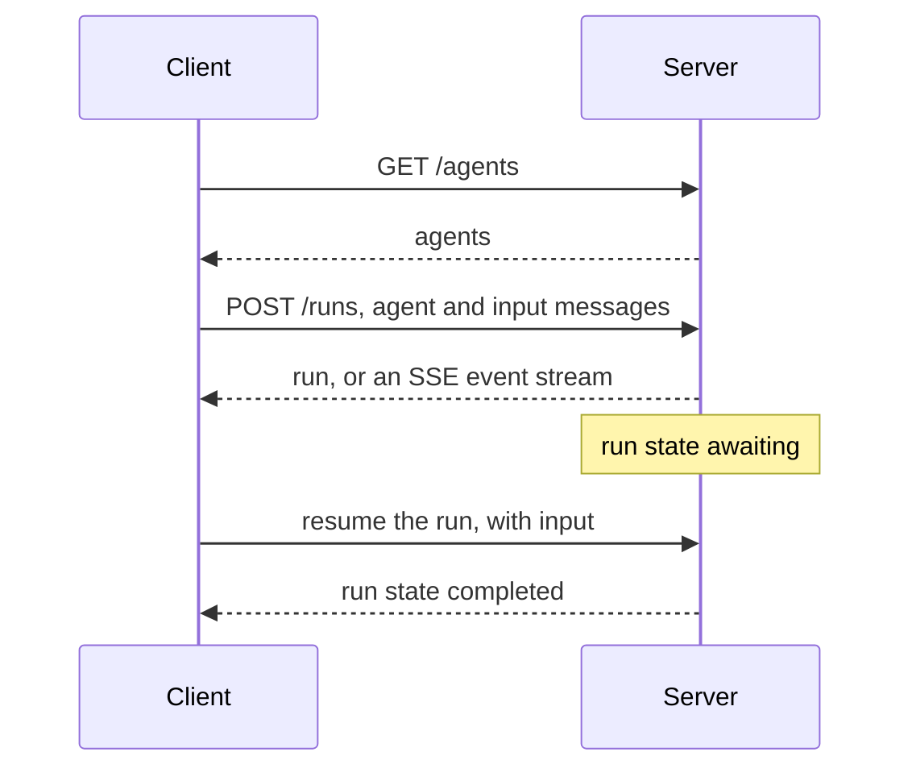

# Agent Communication Protocol (ACP)

IBM's ACP connects clients to agents hosted on an ACP server through a REST API. IBM Research published it in March 2025 for the BeeAI platform and gave it to the Linux Foundation the same month. In August 2025 it merged into A2A. The repository is archived, and BeeAI now uses A2A.

Two other protocols use the abbreviation ACP: the [Agent Client Protocol](../agent-client-protocol/) and the [Agentic Commerce Protocol](../agentic-commerce-protocol/).

| | |
| --- | --- |
| Layer | agent |
| Author | IBM Research |
| Steward | Linux Foundation |
| Version | 0.2.0 |
| Status | merged into [A2A](../a2a/) |
| Spec | <https://agentcommunicationprotocol.dev> |
| Repository | <https://github.com/i-am-bee/acp> |
| Schema | <https://github.com/i-am-bee/acp/blob/main/docs/spec/openapi.yaml> |
| License | Apache-2.0 |

## Roles

- **Client.** An application, a person or another agent.
- **Server.** Hosts one or more agents and runs them on request.

## Transport

HTTP. Responses come back whole or as a Server-Sent Events stream.

## Messages

REST with JSON bodies, described in OpenAPI 3.1. Not JSON-RPC.

Endpoints:

- `GET /ping`
- `GET /agents`, `GET /agents/{name}`
- `POST /runs`
- `GET /runs/{run_id}`, `POST /runs/{run_id}/cancel`, `GET /runs/{run_id}/events`
- `GET /session/{session_id}`

A message has a role and an ordered list of parts. Each part has a `content_type` and either inline `content` or a `content_url`.

## Connection

There is no handshake. The client starts a run with `POST /runs`, naming the agent and giving the input messages. A run is synchronous, asynchronous or streamed.

A run moves through the states created, in-progress, awaiting, cancelling, completed and failed. In the awaiting state the agent waits for input from the client, and the client resumes the run with that input. A `session_id` keeps state across runs for stateful agents.



## Discovery

- `GET /agents` lists the agents on a server.
- An agent manifest at `/.well-known/agent.yml` for open discovery.
- Registries, and manifests embedded in agent packages for offline discovery.

## Authentication

Not part of the protocol. The documentation defers to standard HTTP mechanisms: TLS, Basic, Bearer tokens, JWT, and reverse proxies.

## Example

Source: <https://github.com/i-am-bee/acp/blob/main/docs/introduction/quickstart.mdx>

```http
POST /runs
Content-Type: application/json

{
  "agent_name": "echo",
  "input": [
    { "role": "user", "parts": [{ "content": "Howdy!", "content_type": "text/plain" }] }
  ]
}
```

```json
{
  "run_id": "44e480d6-9a3e-4e35-8a03-faa759e19588",
  "agent_name": "echo",
  "session_id": "b30b1946-6010-4974-bd35-89a2bb0ce844",
  "status": "completed",
  "await_request": null,
  "output": [
    {
      "role": "agent/echo",
      "parts": [
        {
          "name": null,
          "content_type": "text/plain",
          "content": "Howdy!",
          "content_encoding": "plain",
          "content_url": null
        }
      ]
    }
  ],
  "error": null
}
```

## Versions

The OpenAPI document is version 0.2.0. The SDKs were released separately; the last release was 1.0.3 on 2025-08-21.

## References

- Specification: <https://agentcommunicationprotocol.dev>
- Repository (archived): <https://github.com/i-am-bee/acp>
- Merge announcement: <https://github.com/orgs/i-am-bee/discussions/5>
