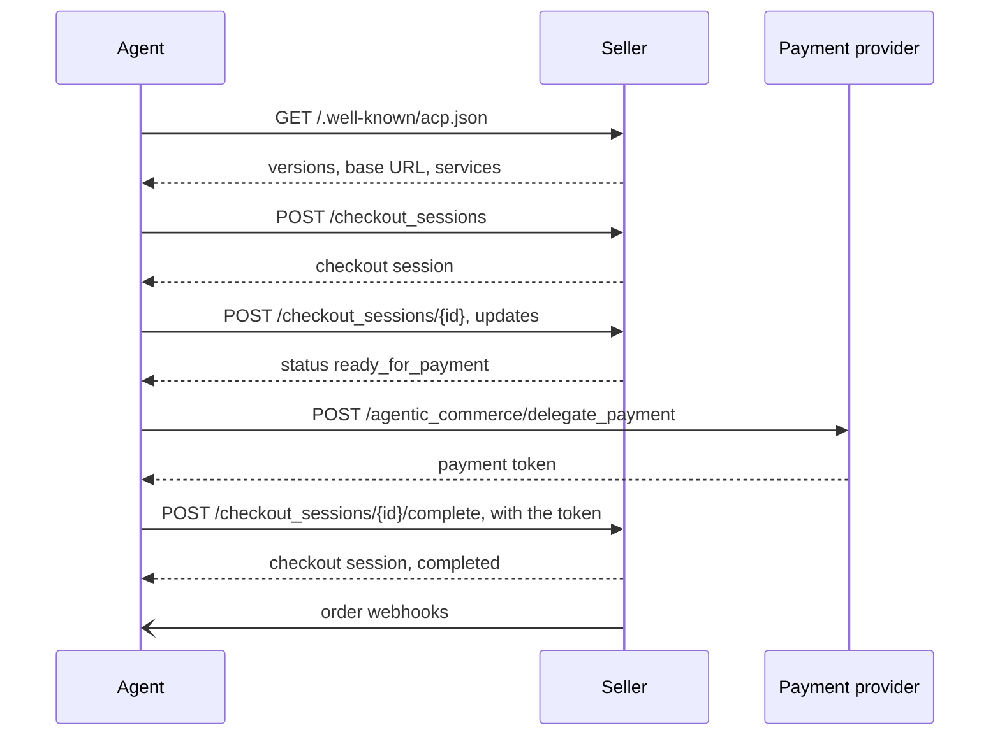

# Agentic Commerce Protocol (ACP)

The Agentic Commerce Protocol lets a buyer's AI agent buy from a seller. The seller exposes a checkout API. The agent creates a checkout session, updates it as the buyer decides, and completes it with a payment token that the payment provider issued for that purchase only. The seller keeps its own payment processing and stays the merchant of record.

The spec is labeled beta. Two other protocols use the abbreviation ACP: the [Agent Client Protocol](../agent-client-protocol/) and the [Agent Communication Protocol](../agent-communication-protocol/).

| | |
| --- | --- |
| Layer | commerce |
| Author | OpenAI and Stripe |
| Steward | OpenAI and Stripe |
| Version | 2026-04-17 (2026-04-17) |
| Status | active |
| Spec | <https://agenticcommerce.dev> |
| Repository | <https://github.com/agentic-commerce-protocol/agentic-commerce-protocol> |
| Schema | <https://github.com/agentic-commerce-protocol/agentic-commerce-protocol/tree/main/spec/2026-04-17> |
| License | Apache-2.0 |

A technical steering committee governs the spec. OpenAI and Stripe appoint its members and keep a veto. Meta joined it on 2026-04-24.

## Roles

- **Agent.** The buyer's AI agent and the platform it runs on.
- **Seller.** Exposes the checkout API and fulfils orders.
- **Payment service provider.** Issues delegated payment tokens and runs authentication such as 3-D Secure.

## Transport

- **REST** over HTTPS.
- **MCP.** JSON-RPC 2.0 over MCP's Streamable HTTP transport, described in OpenRPC.

## Messages

JSON. Amounts are in minor units. The spec is described in OpenAPI and JSON Schema.

- **Checkout.** `POST /checkout_sessions`, `POST /checkout_sessions/{id}`, `GET /checkout_sessions/{id}`, `POST /checkout_sessions/{id}/complete`, `POST /checkout_sessions/{id}/cancel`.
- **Carts.** `/carts`, `/carts/{id}`, `/carts/{id}/cancel`.
- **Orders.** The seller sends order events to the agent's webhook.
- **Delegated payment.** `POST /agentic_commerce/delegate_payment` to the payment provider, and delegated authentication for 3-D Secure.
- **Product feed.** The seller pushes its catalog to the agent, as JSON Lines.

## Connection

1. The agent reads the seller's discovery document.
2. It creates a checkout session. Capabilities are agreed in that request.
3. It updates the session until its status is `ready_for_payment`.
4. It gets a delegated payment token from the payment provider.
5. It completes the session with that token.
6. The seller reports order progress by webhook.



## Discovery

`GET /.well-known/acp.json`, without authentication. It lists the protocol versions, the API base URL, the transports and the services.

## Authentication

A Bearer token in `Authorization`. Requests also carry `API-Version` and `Idempotency-Key`, which is mandatory. Webhooks are signed with HMAC in the `Signature` header, with a `Timestamp`. The agent never holds the buyer's card: the payment provider issues a token scoped to one purchase.

## Example

Discovery, minimal. Source: <https://github.com/agentic-commerce-protocol/agentic-commerce-protocol/blob/main/examples/2026-04-17/examples.agentic_checkout.json>, key `discovery_response_minimal`.

```http
GET /.well-known/acp.json HTTP/1.1
Host: merchant.example.com
```

```json
{
  "protocol": { "name": "acp", "version": "2025-09-29", "supported_versions": ["2025-09-29"] },
  "api_base_url": "https://merchant.example.com/api",
  "transports": ["rest"],
  "capabilities": { "services": ["checkout"] }
}
```

## Versions

Named by release date, `YYYY-MM-DD`, one folder per release under `spec/`. The client sends the version in the `API-Version` header. Releases: 2025-09-29, 2025-12-12, 2026-01-16, 2026-01-30, 2026-04-17.

## References

- Specification: <https://agenticcommerce.dev>
- Repository: <https://github.com/agentic-commerce-protocol/agentic-commerce-protocol>
- Governance: <https://github.com/agentic-commerce-protocol/agentic-commerce-protocol/blob/main/docs/governance.md>
