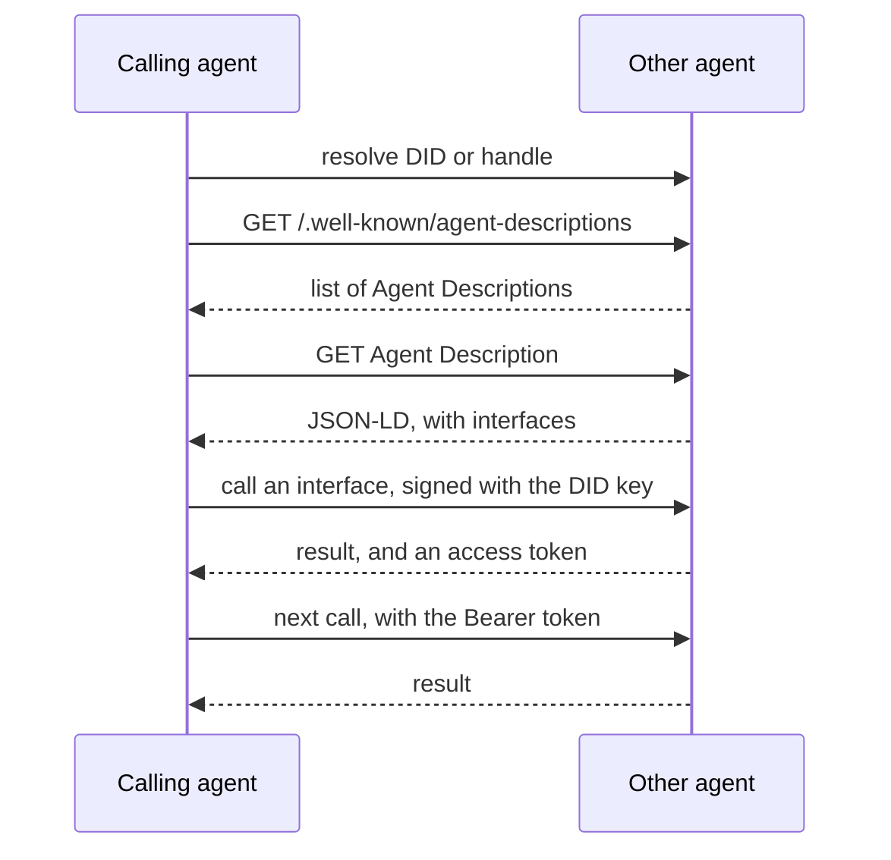

# Agent Network Protocol (ANP)

ANP connects agents across the open internet without a central platform. Each agent has a decentralized identifier (DID). An agent publishes a description of itself and its interfaces, other agents find that description, and then call the agent or send it messages, signing each request with the key behind their DID.

| | |
| --- | --- |
| Layer | agent |
| Author | Gaowei Chang, ANP Open Source Community |
| Steward | ANP Open Source Community |
| Version | 1.2 (2026-09-24) |
| Status | active |
| Spec | <https://agent-network-protocol.com/> |
| Repository | <https://github.com/agent-network-protocol/AgentNetworkProtocol> |
| Schema | None. The spec is a set of Markdown documents. |
| License | Apache-2.0 |

## Roles

Every party is an agent, identified by a DID. In a given exchange one agent calls and the other serves. Search service agents index the descriptions of other agents.

## Transport

HTTPS for identity, descriptions and discovery. For messaging, HTTP(S) and secure WebSocket are the recommended bindings, but other bindings are allowed.

## Messages

The spec is split into layers:

- **Identity.** DIDs, with the `did:wba` method or `did:web`. Handles map readable names to DIDs.
- **Agent Description.** A JSON-LD document with the agent's identity and interfaces. An interface may be defined in OpenRPC, in YAML, or as an MCP server.
- **Discovery.** How descriptions are listed and found.
- **Messaging.** JSON-RPC 2.0 in profiles for direct messages, groups, end-to-end encryption, attachments, federation relay and mentions.
- **Application protocols.** Built on the layers above, for example payments, which adapts AP2.

Authorization, protocol negotiation and payments are still drafts.

## Connection

1. Resolve the other agent's DID or handle.
2. Find its description, through its domain or a search service.
3. Read the description to learn its interfaces.
4. Call an interface with a request signed by your DID, or send it messages under a messaging profile.



## Discovery

- **Active.** `GET https://{domain}/.well-known/agent-descriptions` returns a JSON-LD page listing the agent descriptions on that domain, with a `next` link for more.
- **Passive.** An agent registers its description URL with a search service agent, through the API in that agent's own description.

## Authentication

By DID. The caller signs the HTTP request with RFC 9421 HTTP Message Signatures, with an RFC 9530 `Content-Digest` when there is a body. The signing key is a verification method in the caller's DID document. After the first check the server may issue an access token, which the caller then sends as a Bearer token. Errors come back in a `WWW-Authenticate: DIDWba` header.

End-to-end encrypted messaging uses keys bound to devices, and MLS for groups.

## Example

Active discovery. Source: <https://github.com/agent-network-protocol/AgentNetworkProtocol/blob/main/08-ANP-Agent-Discovery-Protocol-Specification.md>

```http
GET /.well-known/agent-descriptions HTTP/1.1
Host: agent-network-protocol.com
```

```json
{
  "@context": {
    "@vocab": "https://schema.org/",
    "did": "https://w3id.org/did#",
    "ad": "https://agent-network-protocol.com/ad#"
  },
  "@type": "CollectionPage",
  "url": "https://agent-network-protocol.com/.well-known/agent-descriptions",
  "items": [
    {
      "@type": "ad:AgentDescription",
      "name": "Smart Assistant",
      "@id": "https://agent-network-protocol.com/agents/smartassistant/ad.json"
    },
    {
      "@type": "ad:AgentDescription",
      "name": "Customer Support Agent",
      "@id": "https://agent-network-protocol.com/agents/customersupport/ad.json"
    }
  ],
  "next": "https://agent-network-protocol.com/.well-known/agent-descriptions?page=2"
}
```

## Versions

The spec set is versioned `MAJOR.MINOR`; 1.2 is current. Each document also carries its own version and status (Released or Draft). Messaging profiles have wire ids such as `anp.core.binding.v1`.

## References

- Specification: <https://agent-network-protocol.com/>
- Repository: <https://github.com/agent-network-protocol/AgentNetworkProtocol>
- SDK: <https://github.com/agent-network-protocol/AgentConnect>
