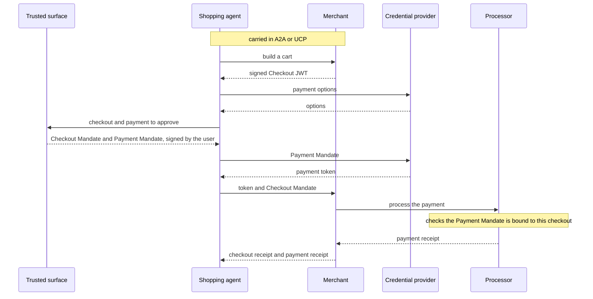

# Agent Payments Protocol (AP2)

AP2 proves that a user authorized a purchase an agent makes for them. It does not move money and has no transport of its own. It defines signed objects, called mandates, that travel inside a commerce protocol such as A2A or UCP. The merchant, the payment provider and the processor can each check a mandate and know what the user agreed to.

Google donated AP2 to the FIDO Alliance on 2026-04-28. Specification work continues there.

| | |
| --- | --- |
| Layer | commerce |
| Author | Google |
| Steward | FIDO Alliance |
| Version | 0.2.0 (2026-04-28) |
| Status | active |
| Spec | <https://ap2-protocol.org/> |
| Repository | <https://github.com/google-agentic-commerce/AP2> |
| Schema | <https://github.com/google-agentic-commerce/AP2/tree/main/code/sdk/schemas/ap2> |
| License | Apache-2.0 |

## Roles

- **Shopping Agent.** Acts for the user.
- **Merchant.** Sells the goods and signs the checkout.
- **Credential Provider.** Holds the user's payment credentials, such as a wallet or an issuer.
- **Merchant Payment Processor.** Processes the payment for the merchant.
- **Trusted Surface.** The non-agentic interface where the user approves and signs.

## Transport

None of its own. AP2 is carried as an extension of A2A or UCP.

## Messages

Objects, not requests. Each is a JSON object secured as an SD-JWT verifiable credential. Other credential formats, such as ISO mDoc, are allowed.

- **Checkout JWT.** The cart, signed by the merchant.
- **Checkout Mandate.** The user's approval of that checkout.
- **Payment Mandate.** The user's approval of the payment.
- **Open mandates.** Approval in advance, with constraints, for purchases the user is not present for.
- **Receipts.** A checkout receipt from the merchant and a payment receipt from the processor.

Both mandates are bound to the hash of the merchant's Checkout JWT.

## Connection

With the user present:

1. The agent builds a cart. The merchant returns a signed Checkout JWT.
2. The agent gets payment options from the credential provider.
3. The user signs the Checkout Mandate and the Payment Mandate on the trusted surface.
4. The credential provider checks the Payment Mandate and issues a payment token.
5. The agent sends the token and the Checkout Mandate to the merchant.
6. The processor checks that the Payment Mandate is bound to this checkout.
7. The merchant and the processor return receipts.

Without the user present, the user signs open mandates beforehand, and the agent's key signs the closed mandates within their constraints. If a constraint cannot be met, the user is asked again.



## Discovery

None in AP2. An A2A agent declares support as an Agent Card extension. A UCP business declares it in its profile.

## Authentication

The mandates are the authorization. The user signs on the trusted surface. User credentials are presented over OpenID for Verifiable Presentations. Agent providers are checked against a trust list.

## Example

A closed Payment Mandate, decoded. Source: <https://github.com/google-agentic-commerce/AP2/blob/main/docs/ap2/payment_mandate.md>

```json
{
  "issuer_signed_jwt": {
    "header": { "alg": "ES256", "typ": "kb+sd-jwt" },
    "payload": {
      "delegate_payload": [{ "...": "G2DuU6IjyDkD-9ItStdsUo48C5uJqDs1E9Hf5GT3TgM" }],
      "iat": 1777342370,
      "aud": "credential-provider",
      "nonce": "a8b7c6d5e4f3a2b1c0d9e8f7a6b5c4d3",
      "sd_hash": "uixoHemmfrrCSbPREo9j-ziLuMkqExsPeWrwA-PK0Ck",
      "_sd_alg": "sha-256"
    }
  },
  "disclosures": [
    {
      "digest": "G2DuU6IjyDkD-9ItStdsUo48C5uJqDs1E9Hf5GT3TgM",
      "decoded": [
        "FW6McBJImqODuhQlpI4Idw",
        {
          "vct": "mandate.payment.1",
          "transaction_id": "NivWhuqfzcvZNapvIEJ2-3tsdQLkiuIcye2g46WVgX8",
          "payee": { "id": "merchant_1", "name": "Demo Merchant", "website": "https://demo-merchant.example" },
          "payment_amount": { "amount": 19900, "currency": "USD" },
          "payment_instrument": { "id": "stub", "type": "card", "description": "Card ••••4242" }
        }
      ]
    }
  ]
}
```

## Versions

The repository uses SemVer tags. Each mandate type is versioned on its own through the suffix of its `vct` claim, for example `mandate.payment.1`. A breaking change gets a new suffix.

## References

- Specification: <https://ap2-protocol.org/>
- Repository: <https://github.com/google-agentic-commerce/AP2>
- FIDO Alliance announcement: <https://fidoalliance.org/fido-alliance-to-develop-standards-for-trusted-ai-agent-interactions/>
